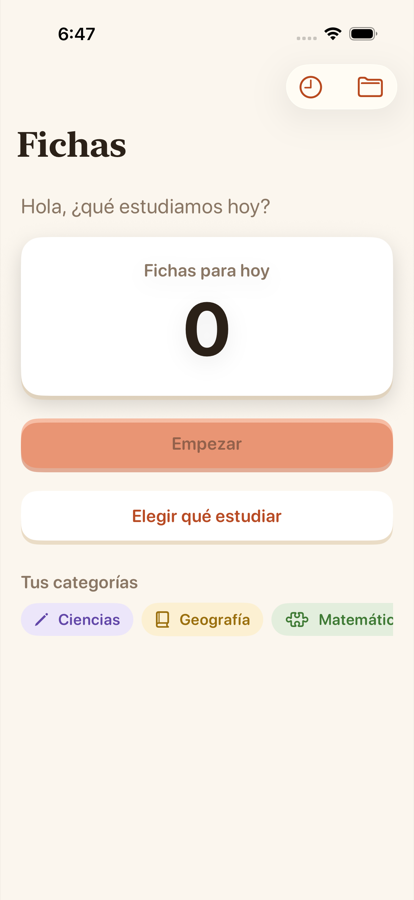
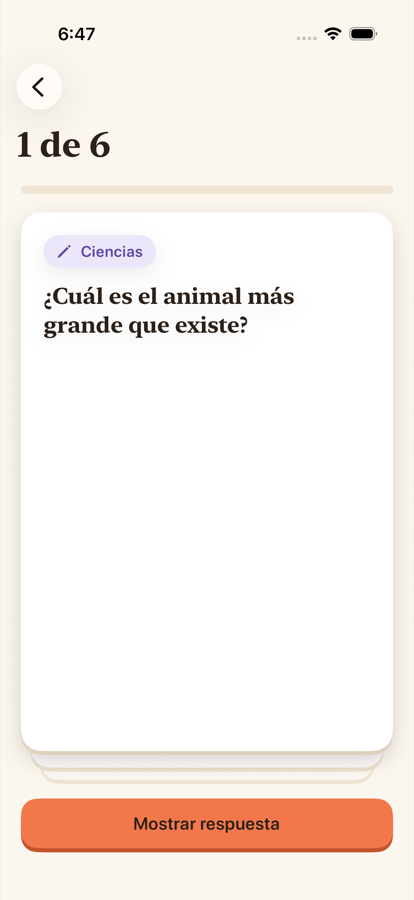
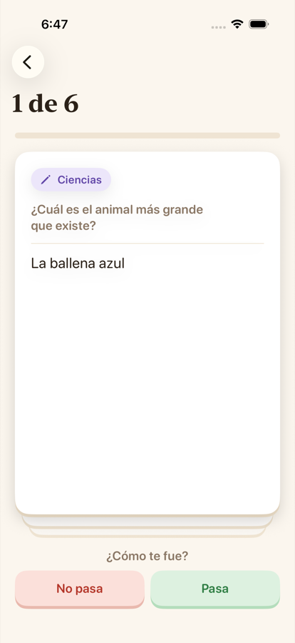
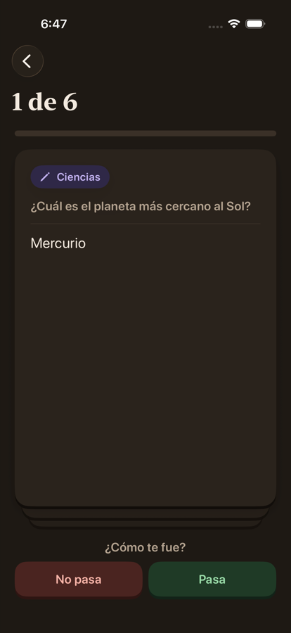
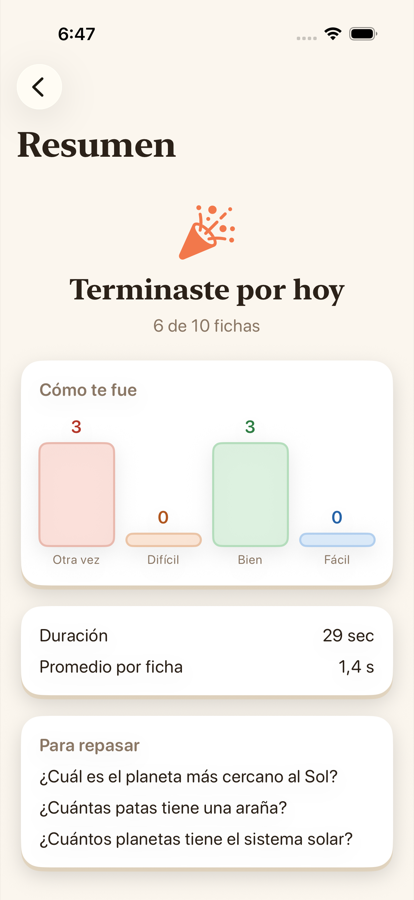

# Interfaz

Esta parte se especifica aparte de la lógica, para poder comparar implementaciones de interfaz por separado.

## Pantallas mínimas

| Pantalla | Propósito | Requerimientos |
|---|---|---|
| Categorías | Crear, editar y eliminar categorías y subcategorías | REQ-012, REQ-013 |
| Fichas | Listar, crear, editar y eliminar fichas dentro de una categoría | REQ-010 a REQ-017 |
| Nueva sesión | Elegir categorías o subcategorías y número de fichas | REQ-021, REQ-022 |
| Estudio | Mostrar pregunta, contador, respuesta y calificación | REQ-017, REQ-023, REQ-026 |
| Resumen de sesión | Resultado al terminar | REQ-030 |
| Historial | Resultados de sesiones anteriores | REQ-030 |

## Diseño visual

**Estado: propuesta.** La propone Sergio a partir de su implementación ("Cuaderno cálido"); cada participante decide si su app la adopta. No cambia ningún comportamiento ni agrega datos: solo cómo se ven y cómo responden las pantallas de arriba.

### Intención

Que estudiar se sienta como manejar fichas de papel: cálido, claro y con respuesta a cada toque. Alegre sin ser infantil, porque la app la usan un niño y también un adulto. Sin puntos, rachas, vidas ni sonidos: con un usuario menor no se quiere presionar, y además serían comportamiento nuevo.

### Color

| Uso | Modo claro |
|---|---|
| Fondo ("papel") | `#FBF6EE` |
| Texto principal ("tinta") | `#2B2118` |
| Texto secundario | `#8A7765` |
| Líneas y fondos de barra | `#EFE4D3` |
| Tarjeta | `#FFFFFF`, con borde inferior de relieve `#EADCC6` |
| Acento coral (acciones principales y progreso) | `#F2784B`, con relieve `#C4532A` |
| Texto sobre coral | `#2B2118` (el blanco da 2,8:1, por debajo de AA) |
| Coral como texto sobre fondo claro | `#B84B24` (4,8:1) |

Calificaciones del 1 al 5, de rojo a azul (fondo / texto):

| 1 | 2 | 3 | 4 | 5 |
|---|---|---|---|---|
| `#FBE0DA` / `#B4372A` | `#FCE6D6` / `#B1561E` | `#FCF0D2` / `#A07612` | `#DDF1E0` / `#2E7D43` | `#DCEBFA` / `#2563A8` |

"No pasa" usa los colores del 1 y "Pasa" los del 4.

**Modo oscuro:** en la misma familia cálida ("papel de noche", fondo `#1E1914`), no el gris del sistema. Los demás valores quedan a cada implementación, con contraste AA.

**Color e ícono por categoría:** se derivan del nombre de la categoría con un cálculo estable (el mismo nombre da siempre el mismo color e ícono, en cualquier dispositivo y entre arranques), sobre una paleta de unos 8 colores suaves. No se guarda nada. Las subcategorías usan el color de su categoría. Si algún día el usuario los elige, eso sería un campo nuevo y pasa por la especificación.

### Tipografía

- Títulos de pantalla y preguntas de las fichas: serif, en negrita.
- Todo lo demás: una letra redondeada.
- Siempre con los tamaños de texto del sistema, para que respeten el texto grande.

### Componentes

- **Tarjeta:** fondo blanco, esquinas redondeadas, borde inferior de relieve y sombra suave. Reemplaza las listas grises para fichas, categorías y bloques del resumen.
- **Botón principal:** coral, con relieve que se hunde al tocarlo.
- **Botón secundario:** tarjeta blanca con texto coral, también con relieve.
- **Chip de categoría:** píldora con el color suave de la categoría, su ícono y su nombre.

### Interacción en el estudio

1. La ficha se voltea en 3D al tocarla o al pulsar "Mostrar respuesta".
2. Detrás de la ficha asoma una pila de tarjetas cuando quedan más fichas.
3. Vibración suave al revelar y al calificar, donde el dispositivo la tenga.
4. Al calificar, la ficha sale volando: 1–2 o "No pasa" hacia la izquierda, 4–5 o "Pasa" hacia la derecha, 3 hacia arriba.
5. Barra de progreso coral arriba, además del contador "N de M".
6. El tiempo límite se muestra como un anillo que se vacía. Al agotarse, la ficha se voltea sola y se mantiene el aviso.
7. Al terminar, una celebración corta (1–2 segundos) en el resumen.
8. Las animaciones duran menos de medio segundo y no bloquean el siguiente toque. Con "Reducir movimiento" activado, se cambian por fundidos y no hay celebración.

### Referencias

Capturas de la implementación de Sergio (iPhone, fichas de ejemplo):

| Inicio | Pregunta | Respuesta | Respuesta, modo oscuro | Resumen |
|---|---|---|---|---|
|  |  |  |  |  |
